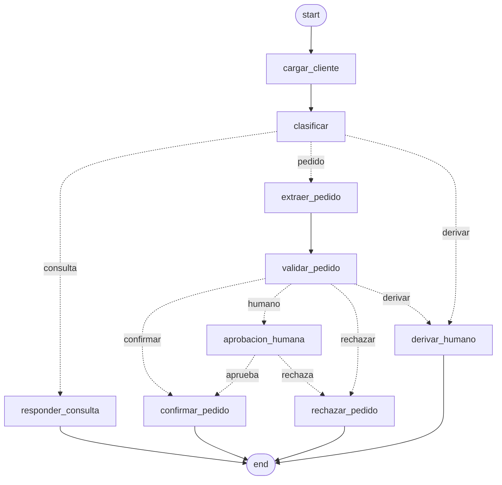

# Mesa de Pedidos

Desafío 1 de la Diplomatura en IA Engineering (ICARO · UNC · FCEFyN).

Un grafo de LangGraph que procesa la bandeja de entrada de una distribuidora mayorista: clasifica cada mensaje, responde consultas citando las políticas de la empresa, arma pedidos contra el catálogo y el crédito reales, y frena a pedir aprobación humana cuando la decisión no le corresponde.

El informe de dos carillas está en [INFORME.md](INFORME.md) y los resultados de la medición en [evaluacion.json](evaluacion.json) (híbrida) y [evaluacion_densa.json](evaluacion_densa.json).

## Cómo correrlo

Requisitos: [uv](https://docs.astral.sh/uv/) y una clave gratuita de [Google AI Studio](https://aistudio.google.com/apikey).

```bash
uv sync                                  # crea el entorno e instala las dependencias
cp .env.example .env                     # y completar GOOGLE_API_KEY
uv run python -m mesa_pedidos.indexado   # indexa los PDF una sola vez
```

Procesar un mensaje de `datos/bandeja.jsonl`:

```bash
uv run python correr.py MSG-009                         # pedido rutinario: se confirma
uv run python correr.py MSG-002                         # consulta: responde citando documento y página
uv run python correr.py MSG-013                         # sin crédito: se frena y muestra el payload
uv run python correr.py MSG-013 --aprobar "comentario"  # retoma (aunque se haya cerrado la terminal)
uv run python correr.py MSG-014 --rechazar "comentario"
uv run python correr.py MSG-009 --de-nuevo              # borra el checkpoint y reprocesa
```

Medir contra el golden set:

```bash
uv run python evaluar.py              # corre lo que falte y escribe evaluacion.json
uv run python evaluar.py --de-nuevo   # vuelve a correr los 20 casos
```

Para comparar con la búsqueda solo densa, poné `RETRIEVER=denso` en el `.env` y corré `uv run python evaluar.py --de-nuevo --salida evaluacion_densa.json`.

Tests y lint (también corren solos con los hooks de pre-commit):

```bash
uv run pytest -q
uv run ruff check . && uv run ruff format --check .
```

## Estructura

```
mesa_pedidos/
├── config.py     rutas, modelos y retriever (se leen del .env)
├── indexado.py   PDF → páginas → chunks → embeddings → FAISS en disco
├── retriever.py  BM25 + denso fusionados con Reciprocal Rank Fusion
├── rag.py        pregunta → chunks → LLM → respuesta con citas verificadas
├── tools.py      consultar_producto y verificar_credito sobre los CSV
├── estado.py     EstadoPedido (TypedDict + reducer) y modelos de Pydantic
├── reglas.py     números de las Condiciones Comerciales, con su artículo
├── nodos.py      los 9 nodos y los 3 routers
└── grafo.py      el cableado, RetryPolicy y SqliteSaver
correr.py         procesa un mensaje y maneja la aprobación
evaluar.py        corre los 20 casos contra el golden set
datos/            PDFs, CSVs, bandeja y golden set de la cátedra
artefactos/       índice FAISS y checkpoints (no se versionan)
```

## El grafo



Se genera con `uv run python -m mesa_pedidos.grafo`.

## Stack

Python 3.12 · uv · LangChain y LangGraph 1.x · Gemini (`gemini-3.5-flash-lite` y `gemini-embedding-001`) · FAISS · BM25 (`rank-bm25`) · SQLite · pytest · ruff · pre-commit.
